# 📚 Studify

**Seu assistente de estudos: matérias, tarefas, provas e lembretes em um só lugar.**


## 👋 Sobre o projeto

O **Studify** é um aplicativo mobile feito para ajudar estudantes a organizar a vida acadêmica. Com ele, o estudante cadastra suas matérias, acompanha tarefas e provas com prazo, visualiza tudo em um calendário e recebe um lembrete no celular antes de cada prova. Os dados ficam salvos na nuvem e sincronizados em tempo real.

O app foi desenvolvido como **projeto final da disciplina Programação para Dispositivos Móveis**, por um grupo de seis integrantes, usando React Native com Expo e Firebase, e organizado no GitHub seguindo o Git Flow.

## 🎯 O problema

Prazos e provas costumam ficar espalhados entre agenda, grupos de WhatsApp e anotações soltas, e o estudante acaba perdendo datas importantes. O Studify reúne tudo isso em um só lugar e avisa antes de cada prova.

**Público-alvo:** estudantes do ensino superior e técnico.

## ⭐ Destaques

- 🔐 Login e cadastro com Firebase Auth, e cada usuário vê só os próprios dados
- 🏠 Tela inicial com a próxima prova e a contagem de dias
- 📖 Matérias com cores, professor e horário de aula
- ✅ Tarefas e provas com prazo, filtro e conclusão com um toque
- 📅 Calendário com os dias de prova marcados
- 📊 Resumo com o progresso geral e por matéria
- 🔔 Lembretes de prova no celular, com antecedência configurável
- 📷 Foto de perfil pela câmera ou galeria

## 📑 Sumário

- [Telas](#-telas)
- [Funcionalidades](#-funcionalidades)
- [Requisitos atendidos](#-requisitos-atendidos)
- [Tecnologias](#️-tecnologias)
- [Navegação](#-navegação)
- [Estrutura dos dados](#️-estrutura-dos-dados-firestore)
- [Como rodar o projeto](#-como-rodar-o-projeto)
- [Git Flow](#-git-flow)
- [Equipe e divisão de tarefas](#-equipe-e-divisão-de-tarefas)

## 📱 Telas

### Boas-vindas e acesso

<p align="center">
  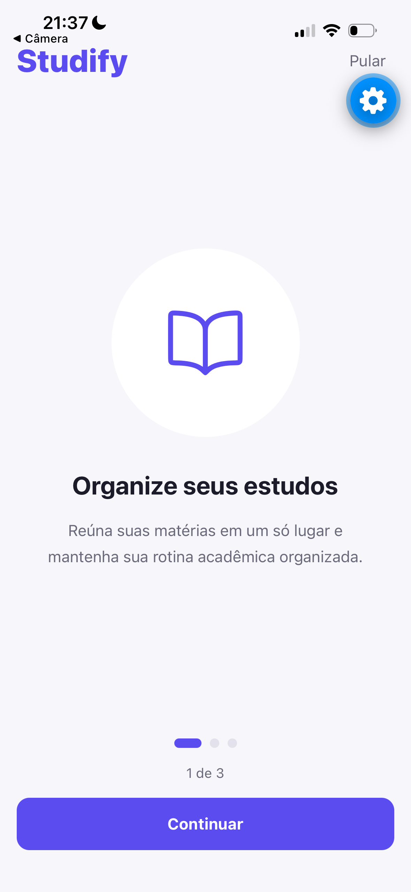
  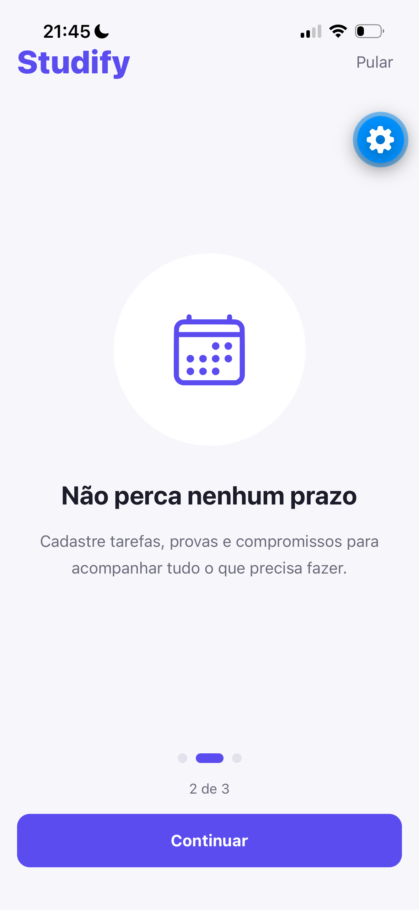
  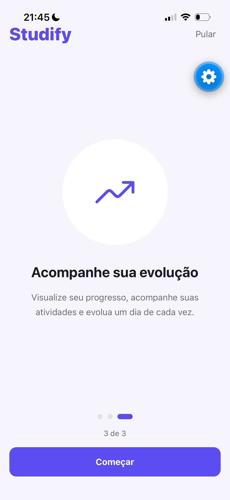
  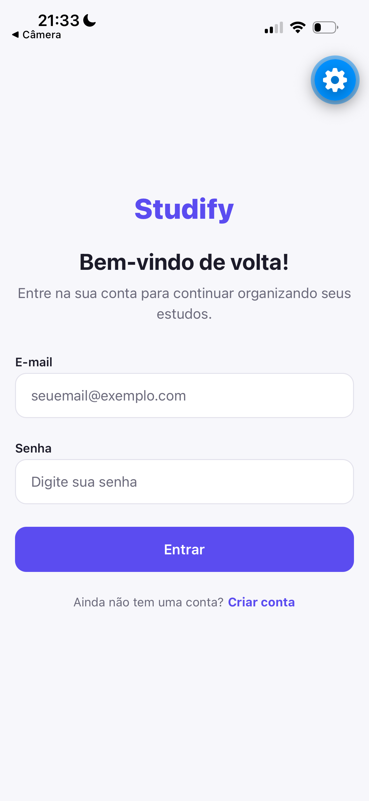
  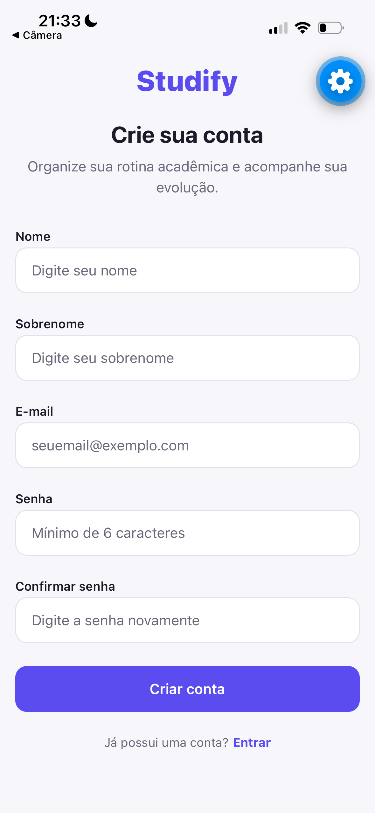
</p>

### Início

<p align="center">
  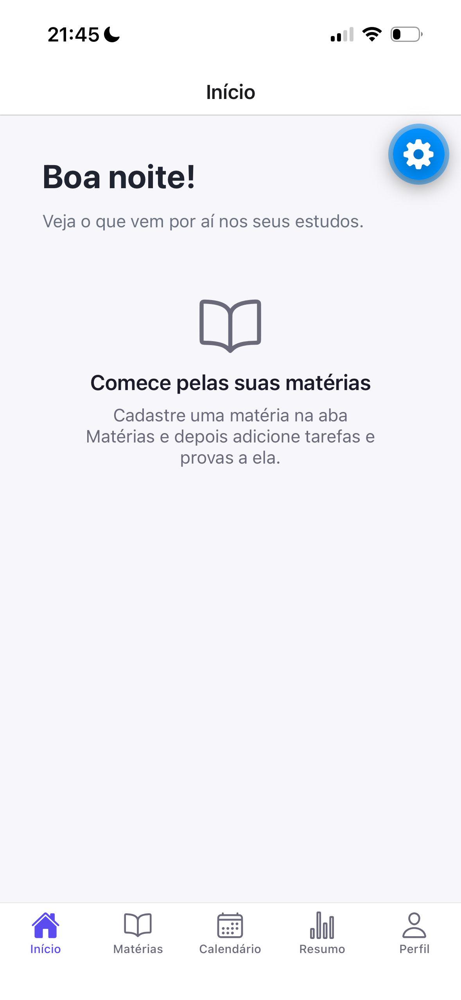
  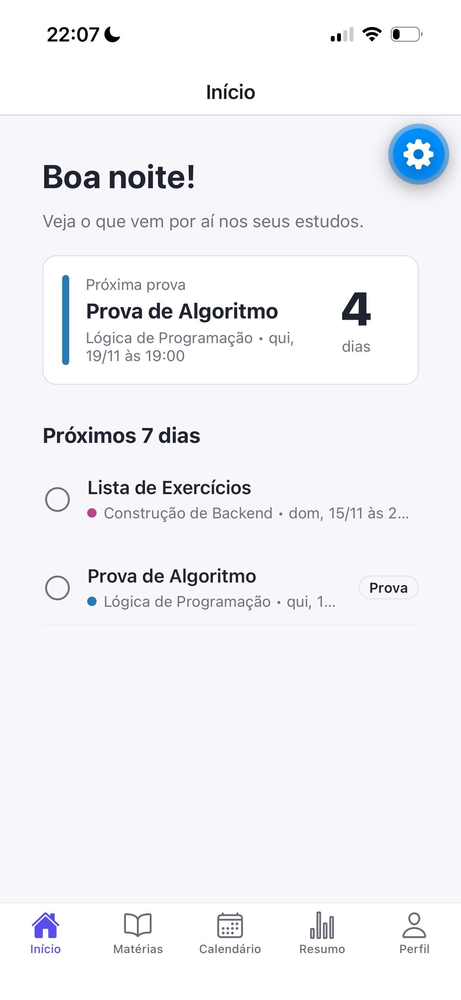
</p>

### Matérias, tarefas e provas

<p align="center">
  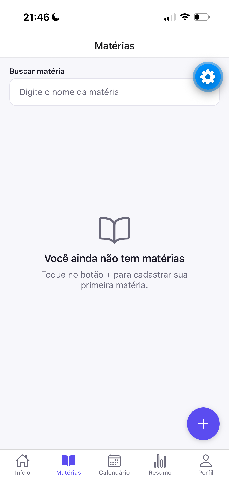
  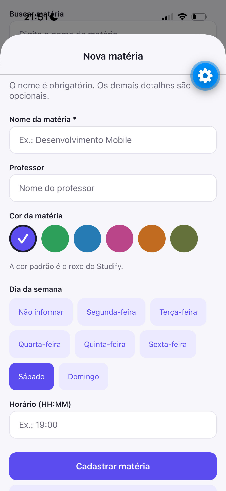
  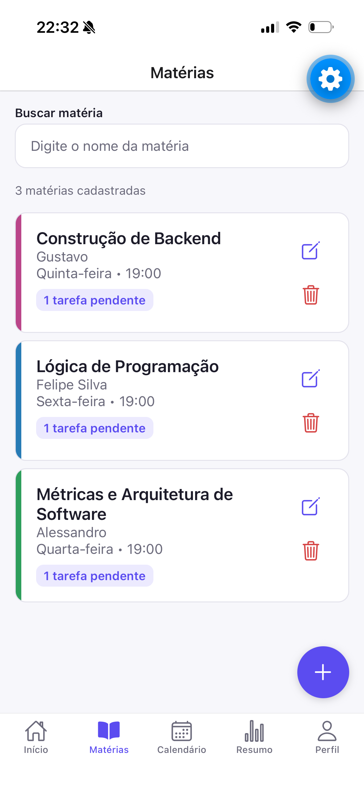
  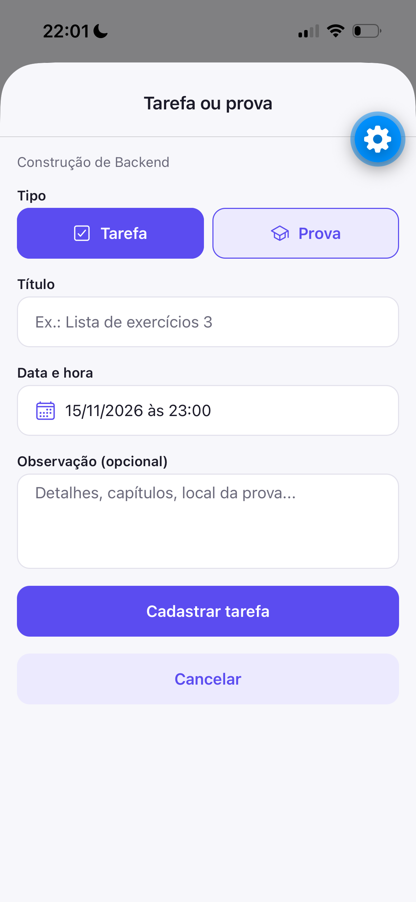
  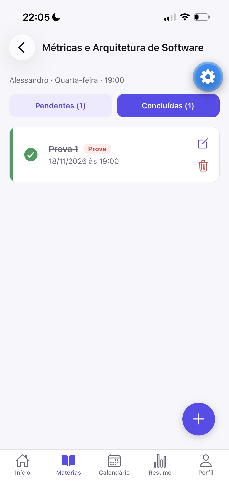
</p>

### Calendário

<p align="center">
  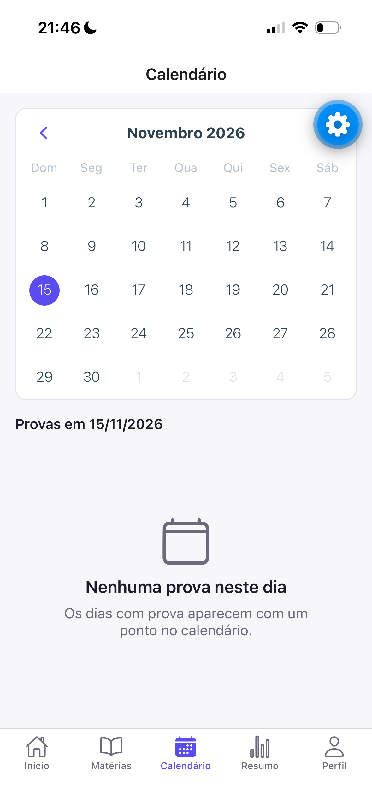
  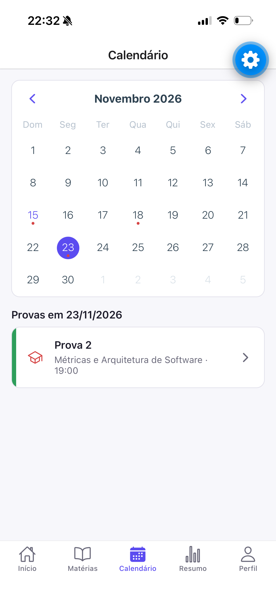
</p>

### Resumo

<p align="center">
  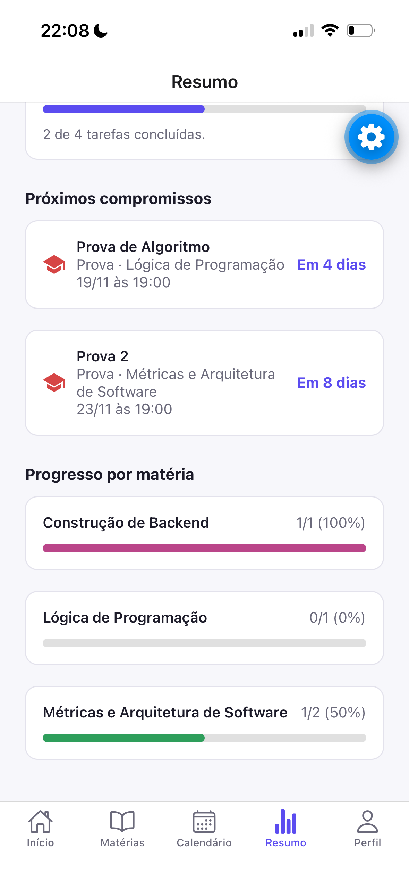
  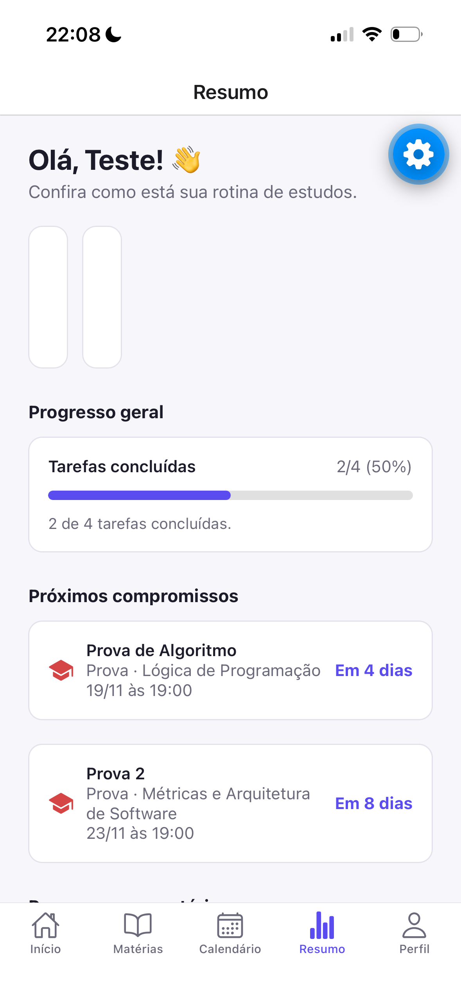
</p>

### Perfil e configurações

<p align="center">
  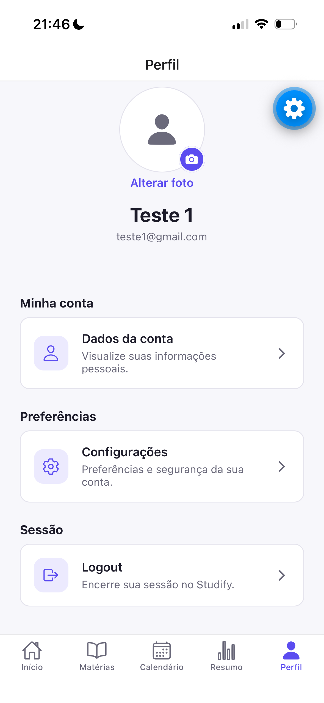
  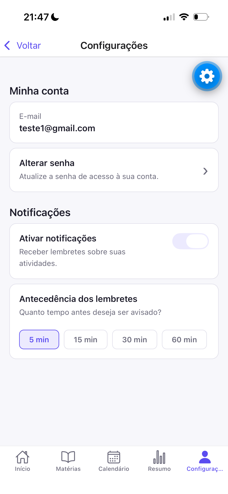
</p>

### Notificação de prova

<p align="center">
  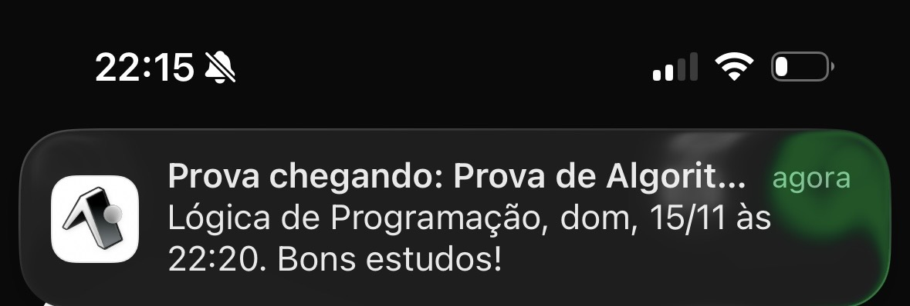
</p>

## ✨ Funcionalidades

| Tela | O que faz |
|---|---|
| **Boas-vindas** | Três slides apresentando o app, exibidos logo depois de criar a conta |
| **Login e Cadastro** | Entrar e criar conta com e-mail e senha (Firebase Auth), com validação e mensagens de erro em português |
| **Início** | Saudação por horário, card da próxima prova com contagem de dias e tarefas dos próximos 7 dias com atalho para concluir |
| **Matérias** | Lista em cards com a quantidade de tarefas pendentes, busca por nome e confirmação antes de excluir |
| **Formulário de matéria** | Nome, professor, cor, dia e horário da aula, com validação. A mesma tela serve para criar e editar |
| **Detalhe da matéria** | Tarefas e provas da matéria com filtro Pendentes/Concluídas e conclusão com um toque |
| **Formulário de tarefa/prova** | Título, tipo, data e hora pelo DateTimePicker e observação, com validação de título e de data no passado |
| **Calendário** | Calendário mensal com os dias de prova marcados. Ao tocar em um dia, mostra as provas dele |
| **Resumo** | Progresso geral, próximos compromissos e progresso por matéria |
| **Perfil** | Foto de perfil (câmera ou galeria), dados da conta, configurações e logout |
| **Configurações** | Ligar ou desligar notificações, escolher a antecedência do lembrete e alterar a senha |

**Notificações de prova:** ao cadastrar uma prova, o app agenda um lembrete local com a antecedência escolhida nas Configurações (5, 15, 30 ou 60 minutos; padrão: 15). Ao editar a prova, o lembrete é reagendado; ao concluir ou excluir, ele é cancelado. Quando o usuário muda a antecedência ou desliga as notificações, os lembretes de todas as provas são atualizados.

## ✅ Requisitos atendidos

| Requisito | Como o Studify atende |
|---|---|
| **Arquitetura e componentização** | Pastas `app/`, `components/`, `contexts/`, `services/`, `hooks/`, `utils/` e `constants/`; componentes reutilizáveis (`Button`, `Input`, `Card`, `EmptyState`, `Loading`, `Screen`); layout com Flexbox |
| **Navegação e roteamento** | Expo Router com fluxo boas-vindas → login → Bottom Tabs (5 abas), e Native Stacks dentro das abas Matérias e Perfil |
| **Estados e formulários** | `useState` e `useReducer` nas telas; estado global com `AuthContext`, `EstudosContext` e `ToastContext`; formulários de login, cadastro, matéria, tarefa e dados da conta com validação |
| **Persistência com Firebase** | Firestore com criar, ler, editar e excluir matérias, tarefas e configurações, sincronizado em tempo real |
| **Interface e UX** | Loadings, Toast de sucesso e erro, estados vazios, confirmação ao excluir e saudação por horário |
| **Recursos nativos** | Notificações locais (`expo-notifications`), câmera e galeria para a foto de perfil (`expo-image-picker`), DateTimePicker e ícones do `@expo/vector-icons` |
| **Git Flow** | Branches `main`, `develop` e uma `feature/` por integrante, com Pull Requests revisados antes do merge |
| **Diferencial** | Autenticação de usuários com Firebase Auth |

## 🛠️ Tecnologias

- [React Native](https://reactnative.dev/) com [Expo](https://expo.dev/) (SDK 58) e TypeScript
- [Expo Router](https://docs.expo.dev/router/introduction/) para navegação
- [Firebase](https://firebase.google.com/): Authentication e Cloud Firestore
- [expo-notifications](https://docs.expo.dev/versions/latest/sdk/notifications/) para os lembretes de prova
- [expo-image-picker](https://docs.expo.dev/versions/latest/sdk/imagepicker/) para a foto de perfil
- [react-native-calendars](https://github.com/wix/react-native-calendars) para o calendário
- [@react-native-community/datetimepicker](https://github.com/react-native-datetimepicker/datetimepicker) para escolher data e hora
- [@expo/vector-icons](https://icons.expo.fyi/) para os ícones

## 🧭 Navegação

```
Boas-vindas (logo depois do cadastro)
└── Login ↔ Cadastro
    └── Bottom Tabs
        ├── Início → Detalhe da matéria
        ├── Matérias → Formulário de matéria
        │            → Detalhe da matéria → Formulário de tarefa/prova
        ├── Calendário
        ├── Resumo
        └── Perfil → Dados da conta
                   → Configurações → Alterar senha
```

## 🗄️ Estrutura dos dados (Firestore)

Cada usuário só acessa os próprios dados, que ficam dentro de `users/{uid}`.

| Coleção | Campos |
|---|---|
| `users/{uid}/materias` | `nome`, `professor`, `cor`, `diaSemana`, `horario` |
| `users/{uid}/tarefas` | `titulo`, `tipo` (tarefa ou prova), `prazo`, `observacao`, `concluida`, `materiaId`, `notificacaoId` |
| `users/{uid}/configuracoes/preferencias` | `antecedenciaLembrete` (minutos), `notificacoesAtivas` |

## 📁 Estrutura de pastas

```
src/
├── app/            # Telas e rotas (Expo Router)
│   ├── (auth)/     # Login e cadastro
│   └── (tabs)/     # Início, Matérias, Calendário, Resumo e Perfil
├── components/     # Componentes reutilizáveis
├── constants/      # Tema: cores, espaçamentos e fontes
├── contexts/       # AuthContext, EstudosContext e ToastContext
├── hooks/          # Hooks como useEstudos e useInicio
├── services/       # Firebase, matérias, tarefas e notificações
├── types/          # Tipos compartilhados
└── utils/          # Funções de data e texto
```

## 🚀 Como rodar o projeto

### Pré-requisitos

- [Node.js](https://nodejs.org/) (versão LTS)
- [Git](https://git-scm.com/)
- App **Expo Go** no celular ([Android](https://play.google.com/store/apps/details?id=host.exp.exponent) ou [iOS](https://apps.apple.com/app/expo-go/id982107779))

### 1. Clonar e instalar

```bash
git clone https://github.com/carolinaarosendo/studify.git
cd studify
npm install
```

### 2. Configurar o Firebase

1. Crie um projeto no [console do Firebase](https://console.firebase.google.com/).
2. Em **Authentication**, ative o login por **E-mail/senha**.
3. Em **Firestore Database**, crie o banco de dados.
4. Em **Configurações do projeto → Seus apps**, adicione um app **Web** e copie as credenciais.
5. Na raiz do projeto, copie o arquivo de exemplo:

```bash
cp .env.example .env
```

6. Preencha o `.env` com as credenciais do seu projeto:

```env
EXPO_PUBLIC_FIREBASE_API_KEY=sua_api_key
EXPO_PUBLIC_FIREBASE_AUTH_DOMAIN=seu-projeto.firebaseapp.com
EXPO_PUBLIC_FIREBASE_PROJECT_ID=seu-projeto
EXPO_PUBLIC_FIREBASE_STORAGE_BUCKET=seu-projeto.firebasestorage.app
EXPO_PUBLIC_FIREBASE_MESSAGING_SENDER_ID=000000000000
EXPO_PUBLIC_FIREBASE_APP_ID=1:000000000000:web:0000000000000000
```

> O arquivo `.env` está no `.gitignore` e **nunca** deve ser enviado para o GitHub.

7. Nas **Regras** do Firestore, permita que cada usuário acesse só os próprios dados:

```
rules_version = '2';
service cloud.firestore {
  match /databases/{database}/documents {
    match /users/{uid}/{document=**} {
      allow read, write: if request.auth != null && request.auth.uid == uid;
    }
  }
}
```

### 3. Executar

```bash
npx expo start
```

Leia o QR Code com o Expo Go (Android) ou com a câmera (iOS). Se o celular não conectar, use o modo túnel:

```bash
npx expo start --tunnel
```

> As notificações, a câmera e o seletor de data só funcionam no celular ou no emulador, não na versão web.

### Testando as notificações

Com a antecedência em 15 minutos, cadastre uma prova para daqui a 10 minutos e saia do app. Como a prova está mais perto que a antecedência, o lembrete chega em poucos segundos.

## 🌿 Git Flow

- **`main`**: versão final e estável
- **`develop`**: integra o trabalho de todo o grupo
- **`feature/...`**: uma branch por integrante, criada a partir da `develop`

Cada parte foi enviada por Pull Request para a `develop`, com revisão antes do merge. Os commits seguem o padrão `feat:`, `fix:`, `style:` e `docs:`.

## 👥 Equipe e divisão de tarefas

| Integrante | Responsabilidades |
|---|---|
| **Ana Carolina** | Criação do projeto e do repositório, configuração do Firebase, navegação, tema e componentes base, `EstudosContext` com sincronização em tempo real |
| **Kauã** | Firebase Auth, `AuthContext`, telas de Boas-vindas, Login, Cadastro, Perfil, Dados da conta, Configurações e Alterar senha |
| **Alexandre** | `materiasService`, telas de Matérias e Formulário de matéria, busca e confirmação ao excluir |
| **Ana Clara** | `tarefasService`, telas de Detalhe da matéria, Formulário de tarefa/prova e Calendário |
| **Luiza Eduarda** | Tela Início, notificações de prova, prints e README |
| **Davi** | Toast de sucesso e erro, ícones, tela Resumo, roteiro e demonstração da apresentação |

## 📄 Licença

Este projeto está sob a licença MIT. Veja o arquivo [LICENSE](LICENSE).